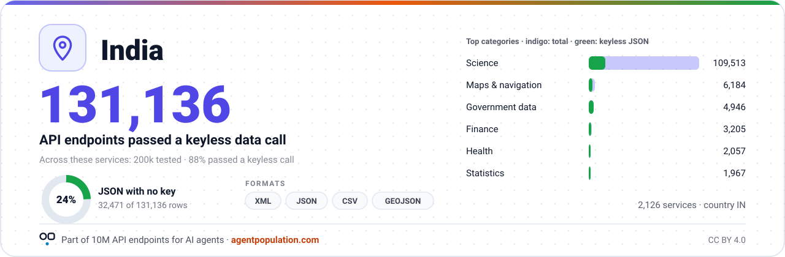
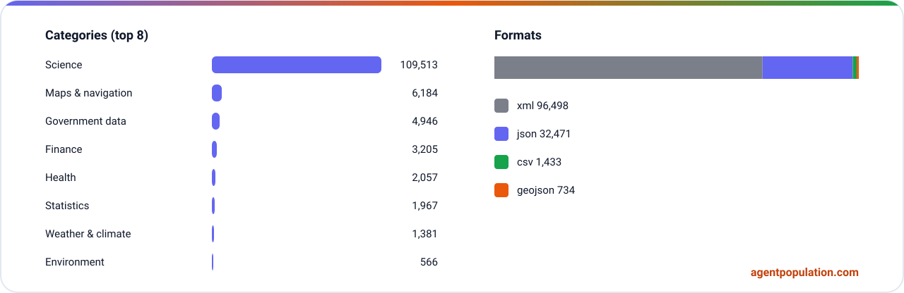

<p align="center"></p>

# 🧭 India API endpoints

**131,136 India API endpoints that answered a keyless GET with a data body. For agent and app builders.**

<p align="center"><a href="#files"></a> <a href="#columns-and-tags"></a> <a href="#whats-inside"></a> <a href="#whats-inside"></a> <a href="LICENSE"></a></p>

<p align="center"><a href="#whats-in-it-for-you">What's in it</a> · <a href="#for-ai-agents">For AI agents</a> · <a href="#quick-start">Quick start</a> · <a href="#test-it-yourself">Test it yourself</a> · <a href="#files">Files</a> · <a href="#licence-and-credit">Licence</a> · <a href="#part-of-10m-api-endpoints-for-ai-agents">More packs</a></p>

This repository holds a 1,000-row sample and the services list; the full list of 131,136 endpoints is one download from the [latest release](https://github.com/agentpopulation/130k-india-apis-for-agents/releases/latest).

**Endpoints for building an agent or app for India.** Airport weather for Indian airports, river and reservoir readings, government open-data records and map layers, as URLs that answered with no key on their test date.

Selection rule: rows where `country is IN`, less the rows that a leave-out rule drops (each counted under Known limits).

61,752 of these 131,136 rows match the focus rule (below); the others are in the pack by the selection rule only, and Known limits says what they are.

## In plain words

**What is an API endpoint?** An API endpoint is one web address that a program can ask for data, for example the latest reading at one weather station. A single service, such as a national weather agency, can have thousands of endpoints: one per station, city or dataset. This pack counts endpoints, not separate services.

**What does "passed a data call" mean?** On the date shown in each row, AgentPopulation sent one plain request to that address, with no password or key, and got a non-empty data body back (JSON, CSV, XML or a file): not an error page and not an empty result. Some bodies describe a dataset rather than hold its values; see Known limits. It shows the address answered with data on that day. It is not a promise that it answers today, and licences and usage limits were not reviewed.

## What's in it for you

Four ways to use this pack. Each bucket gives a count, a filter you can apply to the CSV, one example that passed, and a list of recommended starting points with the rule that picked them. Buckets overlap; a row can fit more than one.

Examples, recommended lists and the preview are drawn from rows that match this pack's focus rule, so a row that the country code put in this pack but that is about something else is not shown as a starting point. Counts cover the whole bucket.

<details>
<summary>The focus rule</summary>

Focus rule: `host ends with ".in" OR host in (aviationweather.gov, api.open-meteo.com, air-quality-api.open-meteo.com, api.met.no, api.sunrise-sunset.org, ckan.himdataportal.com, ckan.meghalayadataportal.com) OR title matches /india|andhra|yamuna/i`

</details>

### 🤖 Agent tools: Airport weather lookups for Indian airports

**261** endpoints from 1 service · Wrap a METAR or TAF URL as a get_airport_weather tool: pass the ICAO code (VIDP, VABB), return the latest report.

Start with: `tags has agent-ready AND url matches /aviationweather\.gov/api/data/(metar|taf)/i`

Example: [METAR: Ahmadabad/Patel Intl (VAAH)](https://aviationweather.gov/api/data/metar?ids=VAAH&format=json) · US Aviation Weather Center · passed 2026-11-14

<details>
<summary>Recommended starting points: 1 service, picked by the stated criteria inside</summary>

**Recommended starting points.** Selected by stated criteria, not a ranking of quality: Services in this pack with the most endpoints that match this bucket and are tagged `agent-ready` (no key sent in the test call, JSON body, passed a data call). Ties go to the service with more country codes, then by name. Only services with at least one bucket row that matches the focus rule are listed, and the sample comes from those rows; the counts cover the whole bucket. The sample URL is the first row by URL sort after preferring, in this order: rows that match the bucket's sample preference when it has one, rows that return values rather than describe a dataset or a service (not ERDDAP /info/ pages, OGC GetCapabilities requests, bare OWS addresses, PxWeb tables, UN SDG series lists, Statistics Canada download pointers, WorldPop listings, GTFS validation reports, untitled rows or service root addresses), and agent-ready rows. Services named "ArcGIS organization" hold map layers from many owners and are added only when fewer than 5 other services match.

Only 1 service matches this bucket and the focus rule in this pack.

| Service (host) | Endpoints in bucket | In pack | Country codes in bucket | Formats in bucket | Sample URL that passed |
|---|---:|---:|---|---|---|
| US Aviation Weather Center (aviationweather.gov) | 261 | 261 | IN | json | [METAR: Ahmadabad/Patel Intl (VAAH)](https://aviationweather.gov/api/data/metar?ids=VAAH&format=json) (2026-11-14) |

</details>

### 📱 App features: River, map and transport layers

**7,936** endpoints from 290 services · Show river readings, map layers and transport layers in an app.

Start with: `tags has rivers OR tags has maps OR tags has transit`

Example: [ISRO NRSC Bhuvan: Bhuvan WMS layer legend JSON (N…](https://bhuvan-vec1.nrsc.gov.in/bhuvan/wms?service=WMS&request=GetLegendGraphic&format=application/json&layer=nuis:AND_PB_UL10K) · Nrsc · passed 2026-11-15

<details>
<summary>Recommended starting points: 8 services, picked by the stated criteria inside</summary>

**Recommended starting points.** Selected by stated criteria, not a ranking of quality: Services in this pack with the most endpoints that match this bucket and passed a data call. Ties go to the service with more country codes, then by name. Only services with at least one bucket row that matches the focus rule are listed, and the sample comes from those rows; the counts cover the whole bucket. The sample URL is the first row by URL sort after preferring, in this order: rows that match the bucket's sample preference when it has one, rows that return values rather than describe a dataset or a service (not ERDDAP /info/ pages, OGC GetCapabilities requests, bare OWS addresses, PxWeb tables, UN SDG series lists, Statistics Canada download pointers, WorldPop listings, GTFS validation reports, untitled rows or service root addresses), and agent-ready rows. Services named "ArcGIS organization" hold map layers from many owners and are added only when fewer than 5 other services match.

| Service (host) | Endpoints in bucket | In pack | Country codes in bucket | Formats in bucket | Sample URL that passed |
|---|---:|---:|---|---|---|
| Nrsc (bhuvan-vec2.nrsc.gov.in) | 994 | 994 | IN | xml | [NRSC Bhuvan vector services (vec2): NRS…](https://bhuvan-vec2.nrsc.gov.in/bhuvan/Anganwadi/Anganwadi/wms?service=WMS&version=1.3.0&request=GetCapabilities) (2026-11-15) |
| Nrsc (bhuvan-vec1.nrsc.gov.in) | 953 | 953 | IN | json, xml, geojson | [ISRO NRSC Bhuvan: Bhuvan WMS layer lege…](https://bhuvan-vec1.nrsc.gov.in/bhuvan/wms?service=WMS&request=GetLegendGraphic&format=application/json&layer=nuis:AND_PB_UL10K) (2026-11-15) |
| Nrsc (bhuvan-vec3.nrsc.gov.in) | 951 | 951 | IN | json, xml, geojson | [ISRO NRSC Bhuvan: Bhuvan WMS layer lege…](https://bhuvan-vec3.nrsc.gov.in/bhuvan/wms?service=WMS&request=GetLegendGraphic&format=application/json&layer=NHAI_FLOOD2:AgencyCurrent) (2026-11-15) |
| Webgis (webgis.nic.in) | 367 | 367 | IN | json | [MyMapService / World Continents](https://webgis.nic.in/publishing/rest/services/MyMapService/MapServer/0/query?where=1%3D1&outFields=*&resultRecordCount=10&f=json) (2026-11-15) |
| Bhubaneswarone (bhubaneswarone.in) | 290 | 290 | IN | json | [Bhubaneswar Smart City (Bhubaneswar One…](https://bhubaneswarone.in/arcgis/rest/services/BhubaneswarOne/ASIMap/MapServer/1/query?where=1%3D1&outFields=*&returnGeometry=false&resultRecordCount=5&f=json) (2026-11-15) |
| Wwfindiawebgis (wwfindiawebgis.in) | 250 | 250 | IN | json | [WWF India WebGIS: WWF India WebGIS ArcG…](https://wwfindiawebgis.in/gisserver/rest/services/Administrative_Boundary/FeatureServer/0/query?where=1%3D1&outFields=*&returnGeometry=false&resultRecordCount=5&f=json) (2026-11-15) |
| Imd (webgis.imd.gov.in) | 244 | 244 | IN | geojson, xml, json | [India Meteorological Department WebGIS:…](https://webgis.imd.gov.in/geoserver/ows?service=WFS&version=1.0.0&request=GetFeature&typeName=EARTHQUAKE:faults&maxFeatures=5&outputFormat=application/json) (2026-11-15) |
| Ncscm (gisportal.ncscm.res.in) | 229 | 229 | IN | json | [National Centre for Sustainable Coastal…](https://gisportal.ncscm.res.in/server/rest/services/Beach/BeachG20_backup/MapServer/0/query?where=1%3D1&outFields=*&returnGeometry=false&resultRecordCount=5&f=json) (2026-11-15) |

</details>

### 🧠 Grounding and data pipelines: Government and civic open-data records

**6,252** endpoints from 309 services · Load government open-data records on a schedule into your own store.

Start with: `tags has open-data OR tags has government`

Example: [River Water Level (Manual - Hourly),Tapi, Gujarat…](https://nwdp.nwic.gov.in/api/3/action/datastore_search?resource_id=003f10ed-7d78-4749-b5c9-700fa58045a0&limit=1) · Nwic · passed 2026-11-13

<details>
<summary>Recommended starting points: 8 services, picked by the stated criteria inside</summary>

**Recommended starting points.** Selected by stated criteria, not a ranking of quality: Services in this pack with the most endpoints that match this bucket and passed a data call. Ties go to the service with more country codes, then by name. Only services with at least one bucket row that matches the focus rule are listed, and the sample comes from those rows; the counts cover the whole bucket. The sample URL is the first row by URL sort after preferring, in this order: rows that match the bucket's sample preference when it has one, rows that return values rather than describe a dataset or a service (not ERDDAP /info/ pages, OGC GetCapabilities requests, bare OWS addresses, PxWeb tables, UN SDG series lists, Statistics Canada download pointers, WorldPop listings, GTFS validation reports, untitled rows or service root addresses), and agent-ready rows. Services named "ArcGIS organization" hold map layers from many owners and are added only when fewer than 5 other services match.

| Service (host) | Endpoints in bucket | In pack | Country codes in bucket | Formats in bucket | Sample URL that passed |
|---|---:|---:|---|---|---|
| Nwic (nwdp.nwic.gov.in) | 554 | 554 | IN | json | [River Water Level (Manual - Hourly),Tap…](https://nwdp.nwic.gov.in/api/3/action/datastore_search?resource_id=003f10ed-7d78-4749-b5c9-700fa58045a0&limit=1) (2026-11-13) |
| Iudx (cos.iudx.org.in) | 540 | 540 | IN | json | [Indian Urban Data Exchange (IUDX) Catal…](https://cos.iudx.org.in/iudx/cat/v1/item?id=00d08acb-1276-4501-98cd-8db8d6bc1f3b) (2026-11-15) |
| Postalpincode (api.postalpincode.in) | 300 | 300 | IN | json | [Postal PIN Code API (postalpincode.in):…](https://api.postalpincode.in/pincode/110001) (2026-11-15) |
| Kdmc (maps.kdmc.gov.in) | 225 | 225 | IN | json | [Kalyan Dombivli Municipal Corporation G…](https://maps.kdmc.gov.in/agserver/rest/services/KDMC_BASEMAP_24_04_2025/FeatureServer/1/query?where=1%3D1&outFields=*&returnGeometry=false&resultRecordCount=5&f=json) (2026-11-15) |
| Canadian Urban Data Catalogue (CUDC) (raw.githubusercontent.com) | 184 | 228 | IN | csv, geojson, json, xml | [DataMeet: GitHub dataset datameet/india…](https://raw.githubusercontent.com/datameet/india-election-data/master/affidavits/adr-2009.csv) (2026-11-15) |
| Justicehub (justicehub.in) | 108 | 108 | IN | json, csv | [Union budget data for the Centrally Spo…](https://justicehub.in/api/3/action/datastore_search?resource_id=01eef0f4-1923-49db-9617-2adc54e9f494&limit=1) (2026-11-12) |
| Dngc (dngc.ac.in) | 105 | 105 | IN | xml | [Dera Natung Government College Research…](https://dngc.ac.in/journals/index.php/index/oai?verb=GetRecord&metadataPrefix=oai_dc&identifier=oai:ojs2.dngc.ac.in:article/100) (2026-11-15) |
| Opencity (data.opencity.in) | 104 | 104 | IN | json, csv | [Bengaluru Cycle Rides Data](https://data.opencity.in/api/3/action/datastore_search?resource_id=04d6ef82-c090-48e4-81fb-c1440317a146&limit=1) (2026-11-13) |

</details>

### 🧪 Evals and testing: Varied responses for tool-call tests

**131,136** endpoints · 2,126 services · country IN · 4 formats · Run your tool calls against a fixed set of URLs across formats and record which answer; last_tested is the baseline for your own re-tests.

Start with: the whole pack

Example: [MFAPI.in (AMFI NAV data): Mutual fund list](https://api.mfapi.in/mf) · Mfapi · passed 2026-11-15

<details>
<summary>Recommended starting points: 8 services, picked by the stated criteria inside</summary>

**Recommended starting points.** Selected by stated criteria, not a ranking of quality: Services in this pack that returned the most different formats, then the most endpoints that passed a data call, then by name: a mix of response shapes to test parsers and tool calls. Only services with at least one bucket row that matches the focus rule are listed, and the sample comes from those rows; the counts cover the whole bucket. The sample URL is the first row by URL sort after preferring, in this order: rows that match the bucket's sample preference when it has one, rows that return values rather than describe a dataset or a service (not ERDDAP /info/ pages, OGC GetCapabilities requests, bare OWS addresses, PxWeb tables, UN SDG series lists, Statistics Canada download pointers, WorldPop listings, GTFS validation reports, untitled rows or service root addresses), and agent-ready rows. Services named "ArcGIS organization" hold map layers from many owners and are added only when fewer than 5 other services match.

| Service (host) | Endpoints in bucket | In pack | Country codes in bucket | Formats in bucket | Sample URL that passed |
|---|---:|---:|---|---|---|
| Canadian Urban Data Catalogue (CUDC) (raw.githubusercontent.com) | 228 | 228 | IN | csv, json, geojson, xml | [DataMeet: GitHub dataset datameet/india…](https://raw.githubusercontent.com/datameet/india-election-data/master/affidavits/adr-2009.csv) (2026-11-15) |
| Nrsc (bhuvan-vec1.nrsc.gov.in) | 953 | 953 | IN | json, xml, geojson | [ISRO NRSC Bhuvan: Bhuvan WMS layer lege…](https://bhuvan-vec1.nrsc.gov.in/bhuvan/wms?service=WMS&request=GetLegendGraphic&format=application/json&layer=nuis:AND_PB_UL10K) (2026-11-15) |
| Nrsc (bhuvan-vec3.nrsc.gov.in) | 951 | 951 | IN | json, xml, geojson | [ISRO NRSC Bhuvan: Bhuvan WMS layer lege…](https://bhuvan-vec3.nrsc.gov.in/bhuvan/wms?service=WMS&request=GetLegendGraphic&format=application/json&layer=NHAI_FLOOD2:AgencyCurrent) (2026-11-15) |
| Imd (webgis.imd.gov.in) | 244 | 244 | IN | geojson, xml, json | [India Meteorological Department WebGIS:…](https://webgis.imd.gov.in/geoserver/ows?service=WFS&version=1.0.0&request=GetFeature&typeName=EARTHQUAKE:faults&maxFeatures=5&outputFormat=application/json) (2026-11-15) |
| Incois (erddap.incois.gov.in) | 102 | 102 | IN | xml, json, csv | [Indian National Centre for Ocean Inform…](https://erddap.incois.gov.in/erddap/categorize/cdm_data_type/index.json) (2026-11-15) |
| Incois (samudra.incois.gov.in) | 52 | 52 | IN | geojson, xml, json | [INCOIS Samudra GeoServer: INCOIS Samudr…](https://samudra.incois.gov.in/geoserver/ows?service=WFS&version=1.0.0&request=GetFeature&typeName=it.geosolutions:SOI_STATE_BOUNDARY&maxFeatures=5&outputFormat=application/json) (2026-11-15) |
| raptiffm.fmisc.up.gov.in | 52 | 52 | IN | geojson, json, xml | [Uttar Pradesh Flood Management GIS: Utt…](https://raptiffm.fmisc.up.gov.in//geoserver/ows?service=WFS&version=1.0.0&request=GetFeature&typeName=raptinew:tbl_Rivers_show&maxFeatures=5&outputFormat=application/json) (2026-11-15) |
| Imd (reactjs.imd.gov.in) | 49 | 49 | IN | geojson, xml, json | [India Meteorological Department GeoServ…](https://reactjs.imd.gov.in/geoserver/ows?service=WFS&version=1.0.0&request=GetFeature&typeName=imd:INDIA_NEW_REDUCED1&maxFeatures=5&outputFormat=application/json) (2026-11-15) |

</details>

The same lists are in [recommended.json](recommended.json), ready for an agent to load.

## Questions an agent can answer with this pack

- What is the latest METAR at New Delhi (VIDP)? Try [METAR: New Delhi/Gandhi Intl (VIDP)](https://aviationweather.gov/api/data/metar?ids=VIDP&format=json) (US Aviation Weather Center, passed 2026-11-14).
- Does the TAF for Mumbai (VABB) forecast rain? Try [TAF forecast: Mumbai/Shivaji Intl (VABB)](https://aviationweather.gov/api/data/taf?ids=VABB&format=json) (US Aviation Weather Center, passed 2026-11-14).
- What do river water level telemetry readings show? Try [River Water Level (telemetry - Hourly), West Beng…](https://nwdp.nwic.gov.in/api/3/action/datastore_search?resource_id=01dcfdeb-8ab4-45ab-8fa6-f5a77f143a17&limit=1) (Nwic, passed 2026-11-12).

## What "passed a data call" means

> [!NOTE]
> On the date in `last_tested` (IST), one GET to the URL, sent with no key, returned HTTP 2xx and a non-empty data body. HTML pages and empty results did not pass. The `format` column records what came back. This is a test result for that date, not a promise that the URL answers today. Licences, terms, rate limits, accuracy and freshness were not reviewed. Endpoints are URLs, not separate APIs; many share one service. This pack was tested 10–15 Nov 2026; snapshot 15 Nov 2026.

## For AI agents

Start from keyless JSON endpoints (`agent-ready`). The code below loads `recommended.json` and calls the first recommended service in the Agent tools bucket, with a timeout (`node examples/agent-start.mjs --recommended`). With no argument, `node examples/agent-start.mjs` calls the most recently tested agent-ready row of the sample; pass a `.csv` or `.csv.gz` path to use that file instead. See [examples/agent-start.mjs](examples/agent-start.mjs).

```js
// Node 18+. Loads recommended.json (the local copy, or the raw file on GitHub) and calls one keyless JSON endpoint.
import fs from 'node:fs';

const RAW = 'https://raw.githubusercontent.com/agentpopulation/130k-india-apis-for-agents/main/recommended.json';
const rec = fs.existsSync('recommended.json')
  ? JSON.parse(fs.readFileSync('recommended.json', 'utf8'))
  : await (await fetch(RAW)).json();

const pick = rec.buckets.find((b) => b.id === 'agent').services[0];
try {
  const res = await fetch(pick.sample_url, {
    headers: { 'User-Agent': 'agent-example/1.0' },
    signal: AbortSignal.timeout(15000),
  });
  console.log(pick.service, res.status, res.headers.get('content-type'));
  console.log((await res.text()).slice(0, 300));
} catch (err) {
  console.log(`did not answer now; last passed ${pick.sample_last_tested} (${err.message})`);
}
```

How an agent picks an endpoint:

1. Filter to `agent-ready` and your country or topic.
2. Prefer the newest `last_tested` and the larger services.
3. Call with a timeout and check the body before you use it.

## Quick start

The examples run against the sample in `data/` out of the box (1,000 rows). Each takes an optional path to a `.csv` or `.csv.gz` file instead.

```bash
git clone https://github.com/agentpopulation/130k-india-apis-for-agents.git
cd 130k-india-apis-for-agents
python examples/quickstart.py
node examples/quickstart.mjs
node examples/agent-start.mjs
```

Full list: download `India_API_Endpoints_AgentPopulation_Snapshot_2026-11-15.csv.gz` (131,136 rows, 2.2 MB) from [releases/latest](https://github.com/agentpopulation/130k-india-apis-for-agents/releases/latest), then gunzip it and pass its path. The scripts also read the `.csv.gz` as it is.

```bash
gunzip India_API_Endpoints_AgentPopulation_Snapshot_2026-11-15.csv.gz
python examples/quickstart.py India_API_Endpoints_AgentPopulation_Snapshot_2026-11-15.csv
node examples/quickstart.mjs India_API_Endpoints_AgentPopulation_Snapshot_2026-11-15.csv
```

### curl

Quote the URL: some contain commas.

```bash
curl -sL "https://raw.githubusercontent.com/agentpopulation/130k-india-apis-for-agents/main/data/India_API_Endpoints_AgentPopulation_Sample.csv" | head -n 4
curl -s --max-time 15 "https://aviationweather.gov/api/data/metar?ids=VAAH&format=json" | head -c 600
```

### Python

Standard library only: [examples/quickstart.py](examples/quickstart.py) reads the sample, or the path you pass, keeps agent-ready rows and calls the most recently tested one.

<details>
<summary>The code</summary>

```python
# Python 3, standard library only. Run from a clone of this repository:
#   python examples/quickstart.py [path]
# With no path it reads the sample in data/. Pass the full list from the latest release (.csv or .csv.gz) instead.
# Keeps agent-ready rows and calls the most recently tested one.
import csv
import gzip
import os
import re
import sys
import urllib.request

HERE = os.path.dirname(os.path.abspath(__file__))
path = sys.argv[1] if len(sys.argv) > 1 else os.path.join(HERE, "..", "data", "India_API_Endpoints_AgentPopulation_Sample.csv")
opener = gzip.open if path.endswith(".gz") else open
with opener(path, "rt", newline="", encoding="utf-8") as f:
    rows = list(csv.DictReader(f))

agent = [r for r in rows if "agent-ready" in r["tags"].split("|")]
# Newest test date first; URLs that describe a dataset or a service rather than return values go last.
DESCRIBES = re.compile(r"/erddap/info/|action-report\.json$|[?&]request=getcapabilities|/GeoArea/[^/?]+/List|getFullTableDownloadCSV|hub\.worldpop\.org", re.I)
agent.sort(key=lambda r: r["last_tested"], reverse=True)
agent.sort(key=lambda r: 1 if DESCRIBES.search(r["url"]) else 0)
print(len(rows), "rows,", len(agent), "agent-ready")
if not agent:
    sys.exit(0)

row = agent[0]
req = urllib.request.Request(row["url"], headers={"User-Agent": "agent-example/1.0"})
try:
    with urllib.request.urlopen(req, timeout=15) as res:
        body = res.read(1_000_000).decode("utf-8", "replace")
        print(res.status, res.headers.get("Content-Type"))
        print(body[:300])
except Exception as err:
    print(f"did not answer now; last passed {row['last_tested']} ({err})")
```

</details>

### JavaScript

Reads the sample as JSON because the CSV has quoted commas.

<details>
<summary>The code</summary>

```js
// Node 18+. Reads the sample as JSON (the CSV has quoted commas), local file first.
import fs from 'node:fs';

const FILE = 'data/India_API_Endpoints_AgentPopulation_Sample.json';
const rows = fs.existsSync(FILE)
  ? JSON.parse(fs.readFileSync(FILE, 'utf8'))
  : await (await fetch('https://raw.githubusercontent.com/agentpopulation/130k-india-apis-for-agents/main/data/India_API_Endpoints_AgentPopulation_Sample.json')).json();

const row = rows.find((r) => r.tags.includes('agent-ready'));
const res = await fetch(row.url, { headers: { 'User-Agent': 'agent-example/1.0' }, signal: AbortSignal.timeout(15000) });
console.log(res.status, (await res.text()).slice(0, 300));
```

</details>

### Agent tools

[examples/agent-tools.json](examples/agent-tools.json) holds two tool definitions in the shape most tool-calling APIs accept (name, description, JSON Schema); rename `parameters` if yours uses another key. [examples/quickstart.mjs](examples/quickstart.mjs) implements them:

- `find_endpoints` searches the agent-ready rows of the list by words (their format is json). When you load the tools of more than one pack, prefix the names (for example `india_find_endpoints`) so they do not clash.
- `fetch_endpoint` calls one URL, **refuses any URL that is not in the list** and does not follow redirects. The allowlist is built from the CSV, so a URL injected into a prompt is refused.

The same two tools can sit behind an MCP server.

## Test it yourself

Re-test endpoints from the sample with the same rule: HTTP 2xx and a non-empty body that is not an HTML page. Node 18+, no packages.

```bash
node tools/test-endpoints.mjs
```

It tests the first 50 URLs and prints one line: tested, passed, did not pass. Options: a `.csv` or `.csv.gz` path (the full list from the release), `--limit 50`, `--timeout-ms 10000`, `--out results.csv`. The results file holds `url`, `status`, `passed`, `content_type`, `ms` and `checked_at`; a status of `timeout` or `error:<code>` means no HTTP answer came back. It is polite: GET only, no key sent, at most 4 requests in flight, one at a time per listed host, at least 1 second between requests to one listed host, and reading stops once 256 kB of a body is kept. Redirects are followed and may lead to another host. `results.csv` is in `.gitignore`.

## Preview

One row from each of the five largest services among rows that match the focus rule, services with rows that return values first.

| Title | Service | Country | Format | Tested | Link |
|---|---|---|---|---|---|
| MFAPI.in (AMFI NAV data): Mutual fund list | Mfapi | IN | json | 2026-11-15 | [api.mfapi.in](https://api.mfapi.in/mf) |
| Meteorological & Oceanographic Satellite Data Archival Cent… | Mosdac | IN | xml | 2026-11-15 | [mosdac.gov.in](https://mosdac.gov.in/thredds/catalog.xml) |
| Association of Mutual Funds in India (AMFI): AMFI NAV text … | Amfiindia | IN | csv | 2026-11-15 | [portal.amfiindia.com](https://portal.amfiindia.com/DownloadNAVHistoryReport_Po.aspx?frmdt=01-Apr-2024&todt=05-Apr-2024) |
| ISRO NRSC Bhuvan: Bhuvan WMS layer legend JSON (National Ur… | Nrsc | IN | json | 2026-11-15 | [bhuvan-vec1.nrsc.gov.in](https://bhuvan-vec1.nrsc.gov.in/bhuvan/wms?service=WMS&request=GetLegendGraphic&format=application/json&layer=nuis:AND_PB_UL10K) |
| ISRO NRSC Bhuvan: Bhuvan WMS layer legend JSON (NHAI\_FLOOD2) | Nrsc | IN | json | 2026-11-15 | [bhuvan-vec3.nrsc.gov.in](https://bhuvan-vec3.nrsc.gov.in/bhuvan/wms?service=WMS&request=GetLegendGraphic&format=application/json&layer=NHAI_FLOOD2:AgencyCurrent) |

Browse the 1,000-row sample: [Sample CSV](data/India_API_Endpoints_AgentPopulation_Sample.csv) · [Sample JSON](data/India_API_Endpoints_AgentPopulation_Sample.json).

## What's inside

<p align="center"></p>

<details>
<summary>Categories: top 8</summary>

| Category | Endpoints | |
|---|---:|---|
| Science | 109,513 | `████████████████████` |
| Navigation & Geo/Maps | 6,184 | `█▏` |
| Government & Open Data | 4,946 | `▉` |
| Finance | 3,205 | `▋` |
| Health | 2,057 | `▍` |
| Statistics & Economy | 1,967 | `▍` |
| Weather & Climate | 1,381 | `▎` |
| Environment | 566 | `▏` |

</details>

Formats: xml 96,498 · json 32,471 · csv 1,433 · geojson 734

<details>
<summary>Largest services: top 25 of 2,126</summary>

| Service | Host | Endpoints | Keyless JSON | |
|---|---|---:|---:|---|
| Razorpay † | ifsc.razorpay.com | 1,000 | 1,000 | `████████████████████` |
| Mfapi | api.mfapi.in | 997 | 997 | `████████████████████` |
| Nrsc | bhuvan-vec2.nrsc.gov.in | 994 | 0 | `███████████████████▉` |
| Mosdac | mosdac.gov.in | 993 | 0 | `███████████████████▉` |
| Amfiindia | portal.amfiindia.com | 989 | 0 | `███████████████████▊` |
| Nrsc | bhuvan-vec1.nrsc.gov.in | 953 | 439 | `███████████████████` |
| Nrsc | bhuvan-vec3.nrsc.gov.in | 951 | 339 | `███████████████████` |
| Mospi | api.mospi.gov.in | 664 | 664 | `█████████████▎` |
| Indiadataportal † | ckandev.indiadataportal.com | 572 | 299 | `███████████▌` |
| Nwic | nwdp.nwic.gov.in | 554 | 554 | `███████████▏` |
| Iudx | cos.iudx.org.in | 540 | 540 | `██████████▊` |
| Censusindia | censusindia.gov.in | 498 | 498 | `██████████` |
| Webgis | webgis.nic.in | 367 | 367 | `███████▍` |
| Microdata | microdata.gov.in | 366 | 366 | `███████▍` |
| Postalpincode | api.postalpincode.in | 300 | 300 | `██████` |
| Bhubaneswarone | bhubaneswarone.in | 290 | 290 | `█████▊` |
| US Aviation Weather Center | aviationweather.gov | 261 | 261 | `█████▎` |
| Wwfindiawebgis | wwfindiawebgis.in | 250 | 250 | `█████` |
| Sbmurban † | prodgis.sbmurban.org | 246 | 246 | `████▉` |
| Imd | webgis.imd.gov.in | 244 | 6 | `████▉` |
| Midcindia † | gis.midcindia.org | 242 | 242 | `████▉` |
| Ncscm | gisportal.ncscm.res.in | 229 | 229 | `████▋` |
| Canadian Urban Data Catalogue (CUDC) | raw.githubusercontent.com | 228 | 59 | `████▌` |
| Kdmc | maps.kdmc.gov.in | 225 | 225 | `████▌` |
| Mapservice | mapservice.gov.in | 214 | 214 | `████▎` |

† No row of these services matches the focus rule: the country code put them in this pack, so they are not used as a starting point.

</details>

<details>
<summary>Rows per test date: 10–15 Nov 2026</summary>

| Date (IST) | Endpoints | |
|---|---:|---|
| 2026-11-15 | 129,589 | `████████████████████` |
| 2026-11-14 | 543 | `▏` |
| 2026-11-13 | 287 | `▏` |
| 2026-11-12 | 501 | `▏` |
| 2026-11-11 | 213 | `▏` |
| 2026-11-10 | 3 | `▏` |

</details>

## Files

| File | Rows | Size | Use |
|---|---:|---:|---|
| [data/India_API_Services_AgentPopulation.csv](data/India_API_Services_AgentPopulation.csv) | 2,126 | 74.5 kB | One row per service with its endpoint count in this pack |
| [data/India_API_Endpoints_AgentPopulation_Sample.csv](data/India_API_Endpoints_AgentPopulation_Sample.csv) | 1,000 | 243.0 kB | The sample: focus-rule rows first, each service in proportion to its share; ArcGIS Online layers count as one service |
| [data/India_API_Endpoints_AgentPopulation_Sample.json](data/India_API_Endpoints_AgentPopulation_Sample.json) | 1,000 | 429.0 kB | The same rows as JSON, tags as an array |
| [India_API_Endpoints_AgentPopulation_Snapshot_2026-11-15.csv.gz](https://github.com/agentpopulation/130k-india-apis-for-agents/releases/latest) | 131,136 | 2.2 MB | The full list, gzipped CSV: a download from the latest release, checked by `SHA256SUMS.txt` |
| [tools/test-endpoints.mjs](tools/test-endpoints.mjs) | | | Re-tests endpoints from the sample or the full list |

Sample size: 1,000 rows, which is 1,000 or one third of the pack rounded down, whichever is smaller. Rows that match the focus rule come first. Each service gets rows in proportion to its share of those rows, at least one for the largest services and at most 50% of the sample while other services have rows; ArcGIS Online layers count as one service, whatever their organisation. Within a service, agent-ready rows, rows that return values and the newest test dates come first, and rows are written in turn across services. Service root addresses are placed at the end of the sample.

Full list: download `India_API_Endpoints_AgentPopulation_Snapshot_2026-11-15.csv.gz` (131,136 rows, 2.2 MB) from [releases/latest](https://github.com/agentpopulation/130k-india-apis-for-agents/releases/latest), then gunzip it and pass its path. The scripts also read the `.csv.gz` as it is.

Excel users: Data > From Text/CSV, UTF-8. Files are UTF-8 without a byte-order mark and comma-separated.

## Columns and tags

<details>
<summary>Columns, types and tags</summary>

| Column | Type | Example | Meaning |
|---|---|---|---|
| url | string | [https://api.mfapi.in/mf](https://api.mfapi.in/mf) | The address that was tested |
| title | string | MFAPI.in (AMFI NAV data): Mutual fund l… | Station, dataset or feed name |
| service | string | Mfapi | The service the endpoint belongs to; joins to the services file together with host |
| host | string | api.mfapi.in | Host name of the address |
| country | string | IN | ISO 3166-1 alpha-2 code, or EU; empty when global or unknown |
| category | string | Finance | Category of the endpoint |
| subcategory | string |  | Left empty from the 15 Nov 2026 snapshot; kept so the columns stay the same |
| format | string | json | What the test call returned: json, csv, geojson, xml, gtfs, zip, txt and so on |
| tags | string | `finance\|no-key\|json\|agent-ready` | Tags separated by \| |
| last_tested | date | 2026-11-15 | Date of the test call, YYYY-MM-DD (IST) |

| Tag | Rows | Meaning |
|---|---:|---|
| no-key | 131,136 | No key was sent in the test call |
| science | 111,288 | Topic tag |
| xml | 96,498 | Format of the body |
| agent-ready | 32,471 | No key sent, JSON body, passed a data call on last_tested |
| json | 32,471 | Format of the body |
| maps | 7,440 | Topic tag |
| health | 6,515 | Topic tag |
| government | 5,679 | Topic tag |
| open-data | 5,540 | Topic tag |
| finance | 3,600 | Topic tag |
| statistics | 2,101 | Topic tag |
| weather | 1,847 | Topic tag |
| environment | 1,517 | Topic tag |
| csv | 1,433 | Format of the body |
| oceans | 1,115 | Topic tag |
| economy | 954 | Topic tag |
| geojson | 734 | Format of the body |
| water | 551 | Topic tag |
| rivers | 383 | Topic tag |
| transit | 367 | Topic tag |
| aviation | 355 | Topic tag |
| floods | 266 | Topic tag |
| forecast | 157 | Topic tag |
| climate | 154 | Topic tag |
| hazards | 150 | Topic tag |
| energy | 104 | Topic tag |
| ai-ml | 94 | Topic tag |
| traffic | 59 | Topic tag |
| maritime | 48 | Topic tag |
| parking | 28 | Topic tag |
| groundwater | 21 | Topic tag |
| speech | 13 | Topic tag |
| elevation | 12 | Topic tag |
| air-quality | 11 | Topic tag |
| earthquakes | 11 | Topic tag |
| tides | 9 | Topic tag |
| bike-share | 8 | Topic tag |
| wildfire | 2 | Topic tag |
| geocoding | 1 | Topic tag |

A machine-readable copy of this dictionary is in [datapackage.json](datapackage.json).

</details>

## Known limits

- 17 rows are ERDDAP /info/ pages: they describe a dataset rather than return its values, so the series needs a second request.
- 2,084 rows are map-layer queries with resultRecordCount set: the tested call asked for a few records; change the query to get the full layer.
- 930 rows carry limit=1: the tested call asked for one record; raise the limit or page through.
- 998 rows are open-data portal dataset records, which may return a dataset record with links rather than the table itself.
- 2 rows are service root addresses (the host alone or an API or version path such as /v1, with no query), which may describe the service rather than return data; the sample, examples and recommended lists use other rows first.
- 707 rows are layers on ArcGIS Online, where anyone can publish: some are class projects, tests or copies. Check the owner and the fields before you rely on one.
- Country code IN is taken from the provider when it named one, otherwise from the domain ending, so it does not always mean the data is about India: some map layers and .in domains cover other places. Filter by title or service if you need India-only data.
- Stations and feeds can go quiet after their test date; re-test a URL before you rely on it.
- Not in this pack: endpoints that need a key or a POST, and URLs that did not pass.
- Left out: 411 rows with a private or local address.
- Left out: 61 ArcGIS Survey123 layers (they can hold people's form answers).
- Left out: 8 ArcGIS layers that keep a form's default service name (they can hold people's form answers).
- Left out: 117 rows that passed a data call only from a network location in India.
- Left out: 62 ArcGIS class or coursework layers (lab, assignment, exam, quiz, lesson, exercise, tutorial and final-project layers, copies of class layers, layers named for a person or a person's home, and layers whose name ends in a person's name or holds a student number).
- Left out: 10 ArcGIS layers that hold reports, comments, submissions or form responses sent in by the public.
- Left out: 1 ArcGIS layer that is a record about named people (employee, patient, client or donor lists, home addresses, voter lists, sex offender and missing person layers).
- Left out: 360 rows of server information from Mastodon, PeerTube, Lemmy, Nostr and other social network servers (instance documents name the server's contact person).
- Left out: 5 rows of ArcGIS Online organisations that are class accounts (25 layers or more, at least 50% of them class or coursework layers): their other layers are students' work too.
- Left out: 82 rows of ArcGIS Online organisations that are class accounts (3 class sets or more in at least 20% of their rows, 10 class sets or more with no organisation name, or layers signed by students read by hand): their other layers are students' work too.
- Left out: 6 rows of class sets: one map layer saved under 5 or more students' initials or names in one ArcGIS Online organisation, or in 4 or more students' own organisations.
- Left out: 251 rows of the ArcGIS Online organisations of universities, colleges and schools (many of their layers are students' work).

## Licence and credit

> [!IMPORTANT]
> This list (URLs, titles, tags and test results) is © 2026 AgentPopulation, released under [CC BY 4.0](https://creativecommons.org/licenses/by/4.0/). Credit AgentPopulation and link agentpopulation.com. The data each endpoint returns belongs to its provider and stays under that provider's terms; this licence does not cover it.

Copy-ready credit:

`India API endpoints by AgentPopulation (https://agentpopulation.com), CC BY 4.0, snapshot 15 Nov 2026.`

GitHub's "Cite this repository" button reads [CITATION.cff](CITATION.cff).

<!-- agentpopulation:start -->
## Part of 10M API endpoints for AI agents

This pack is one of the 50 topic packs of [10m-open-apis-for-ai-agents](https://github.com/agentpopulation/10m-open-apis-for-ai-agents), the open collection by [AgentPopulation](https://agentpopulation.com). Target: 10 million+ open API endpoints that pass a keyless API call.

AgentPopulation has tested over 5 million API endpoints: 5,129,834 tested, 3,726,509 passed a data call (snapshot 15 Nov 2026). This is the India pack: 131,136 endpoints from 2,126 services. Packs overlap, so an endpoint can appear in more than one.

For the latest tested endpoints, search [agentpopulation.com/apis](https://agentpopulation.com/apis). This pack is a snapshot from 15 Nov 2026.

Sibling packs that share the most URLs with this one: [380k-science-apis-for-agents](https://github.com/agentpopulation/380k-science-apis-for-agents) (109,513 shared) · [2.2m-agent-ready-apis](https://github.com/agentpopulation/2.2m-agent-ready-apis) (32,406 shared) · [350k-maps-gis-apis-for-agents](https://github.com/agentpopulation/350k-maps-gis-apis-for-agents) (6,167 shared) · [1.2m-government-open-data-apis](https://github.com/agentpopulation/1.2m-government-open-data-apis) (4,947 shared) · [120k-finance-economy-apis-for-agents](https://github.com/agentpopulation/120k-finance-economy-apis-for-agents) (4,549 shared) · [84k-health-apis-for-agents](https://github.com/agentpopulation/84k-health-apis-for-agents) (2,057 shared). The rest are listed in [10m-open-apis-for-ai-agents](https://github.com/agentpopulation/10m-open-apis-for-ai-agents).

Questions, pack requests, reports of endpoints that stopped answering and requests to remove a row go to [Discussions](https://github.com/agentpopulation/10m-open-apis-for-ai-agents/discussions), or to [@agentpopulation](https://x.com/agentpopulation) on X. The packs are a work in progress and corrections are welcome.

Spotted a wrong row or a dead URL? Tell us on X: [@agentpopulation](https://x.com/agentpopulation).

If this pack saved you time, a star helps others find it.

---

Compiled by [AgentPopulation](https://agentpopulation.com) with [AP Desk](https://github.com/agentpopulation/apdesk) · [10m-open-apis-for-ai-agents](https://github.com/agentpopulation/10m-open-apis-for-ai-agents)

<!-- agentpopulation:end -->
